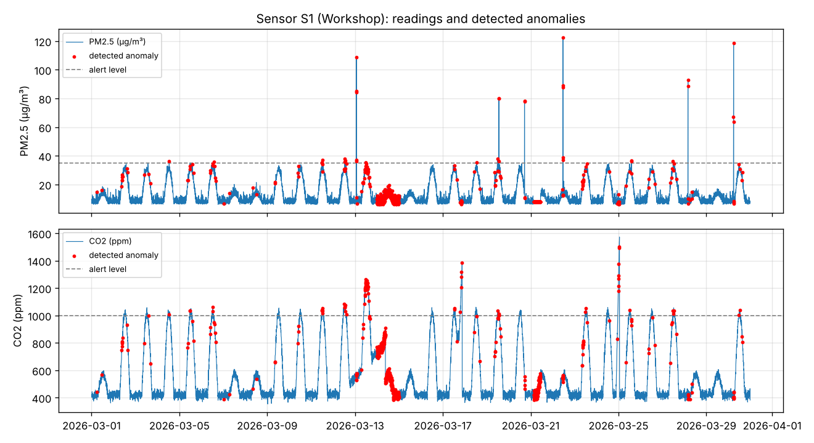
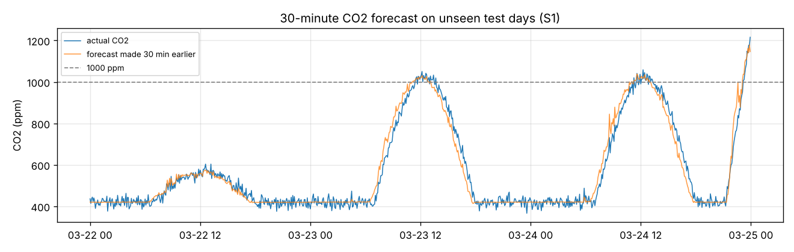

# Air-Quality Anomaly Detection & Power BI Analytics (PFA project)

Indoor air monitoring with multi-sensor nodes: detect anomalies (pollution bursts, ventilation failures, faulty sensors), **predict** CO2 threshold breaches 30 minutes ahead, and expose everything in a **Power BI** dashboard.



## Pipeline

```
sensors (CO2, PM2.5, TVOC, temperature, humidity · every 5 min)
   └─► detection   robust z-score · flatline · night-baseline drift · Isolation Forest
   └─► prediction  gradient-boosted 30-min CO2 forecast → early alerts
   └─► export      star schema CSVs → Power BI (DAX measures + dashboard guide)
```

Each detector targets a failure mode the others miss:

| Detector | Catches | Idea |
|---|---|---|
| Robust z-score (rolling median/MAD) | Pollution spikes | Outlier-resistant baseline, so a spike doesn't hide itself |
| Flatline | Stuck sensor | A real sensor is never perfectly constant for an hour |
| Night-baseline drift | Calibration drift | Empty rooms return to ~420 ppm CO2 at night, if not, the sensor is drifting |
| Isolation Forest | Unusual combinations | e.g. CO2 climbing on a Sunday night with no TVOC rise |

## Results (30 days, 3 sensors, 25,920 readings with labelled incidents)

| Metric | Value |
|---|---|
| Incidents detected | **27 / 28**, median delay **5 min** |
| Reading-level precision / recall | 0.67 / 0.46 (ramp-type incidents start too small to flag in their first minutes) |
| 30-min CO2 forecast MAE | **20.7 ppm** vs 30.4 ppm for a "no change" baseline (−32 %) |
| Predicted-alert precision / recall | 0.78 / 0.87 |
| Median early warning before a 1000 ppm breach | 70 min (search window 90 min) |



## Run it

```bash
pip install -r ../requirements.txt
python run_pipeline.py                    # synthetic data → data/powerbi/*.csv, metrics, figures
python run_pipeline.py --input real.csv   # your own readings
```

Input columns: `timestamp, sensor_id, co2_ppm, pm25_ugm3, tvoc_ppb, temp_c, humidity_pct` (optional `zone`).

## Power BI

Outputs in `data/powerbi/`:

| Table | Grain |
|---|---|
| `fact_readings` | one row per reading, with every detector flag and the anomaly score |
| `fact_alerts` | one row per incident (start, end, duration, type, peak values) |
| `fact_forecast` | actual vs 30-min forecast CO2 and predicted alerts |
| `dim_sensor` | sensor, zone and alert limits |

- [`powerbi/load_data.pq`](powerbi/load_data.pq): Power Query to load and type the tables
- [`powerbi/measures.dax`](powerbi/measures.dax): KPIs, compliance %, air status with colour, detector breakdown, forecast MAE
- [`powerbi/DASHBOARD.md`](powerbi/DASHBOARD.md): step-by-step build of the 3 report pages (Overview, Anomalies, Prediction)

## Data

Real sensor logs aren't published here, so `airq/simulate.py` generates realistic readings (occupancy cycles, weekends, three zones) with four labelled incident types: spikes, ventilation failure, calibration drift and stuck sensors. Labels make the detectors measurable, and `--input` runs the same pipeline on real exports.

## Files

```
airq/simulate.py     synthetic sensor data with labelled anomalies
airq/detect.py       detectors, evaluation, CO2 forecast, incident aggregation
run_pipeline.py      end-to-end run, Power BI export, figures
powerbi/             Power Query, DAX measures, dashboard guide
```
