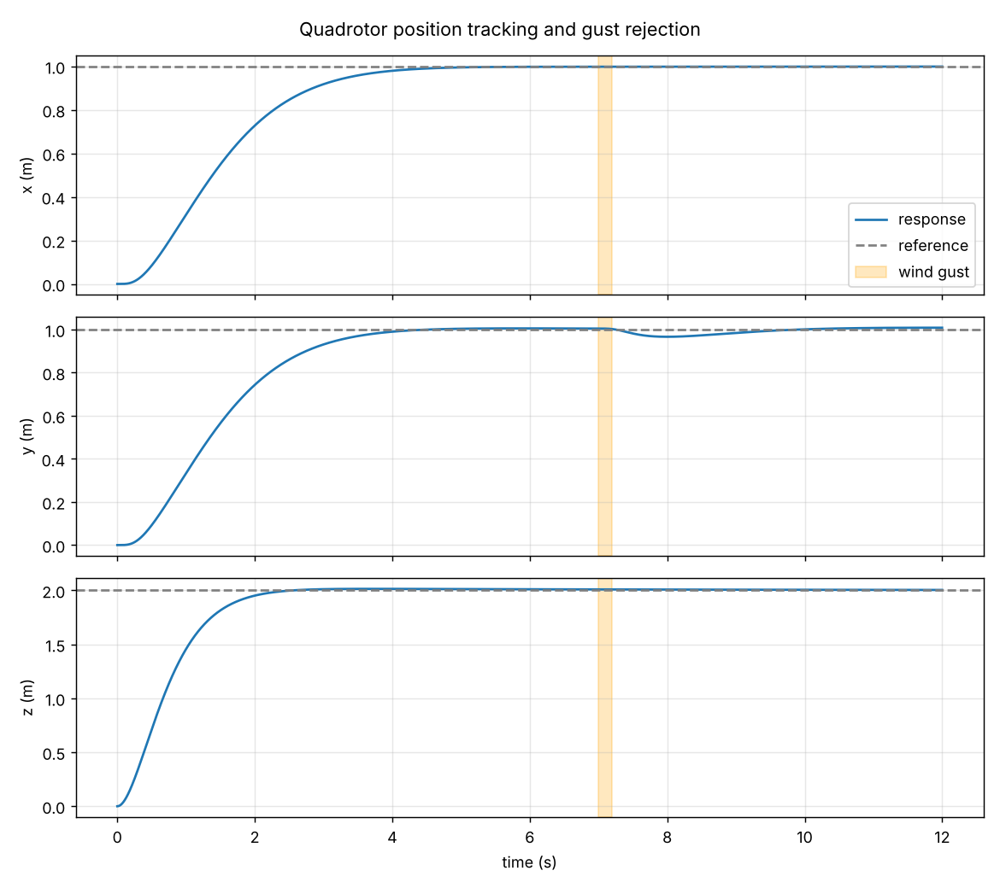
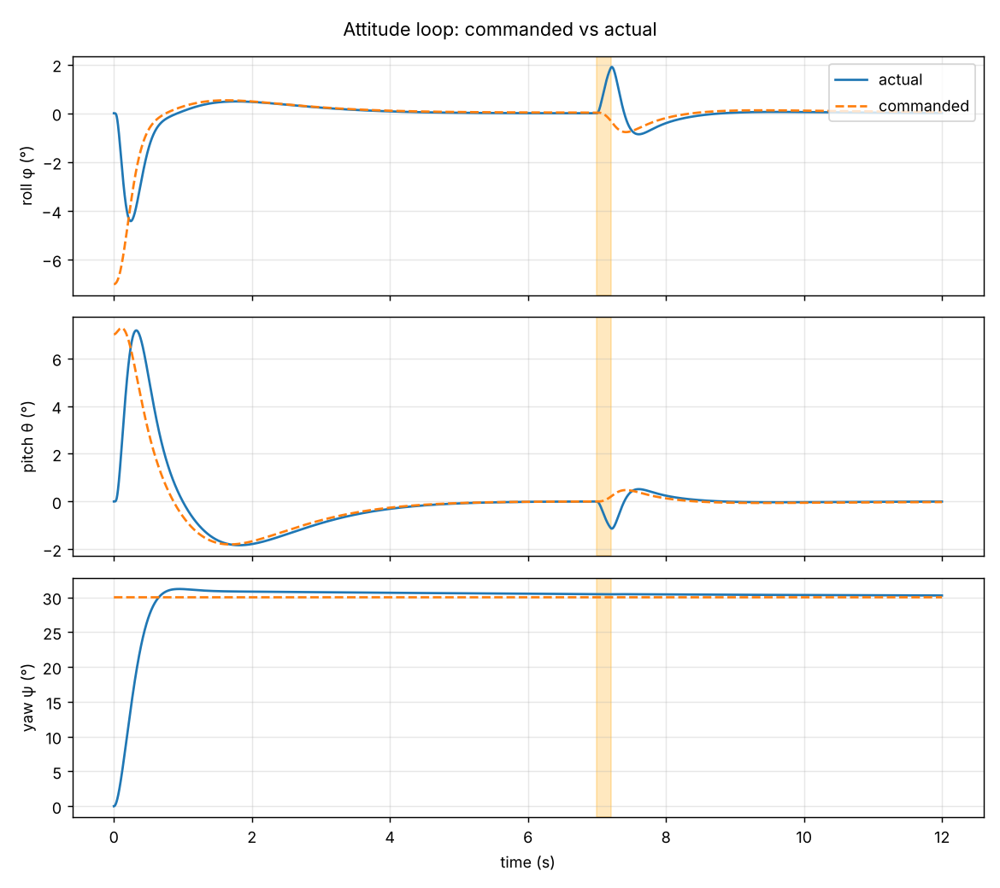
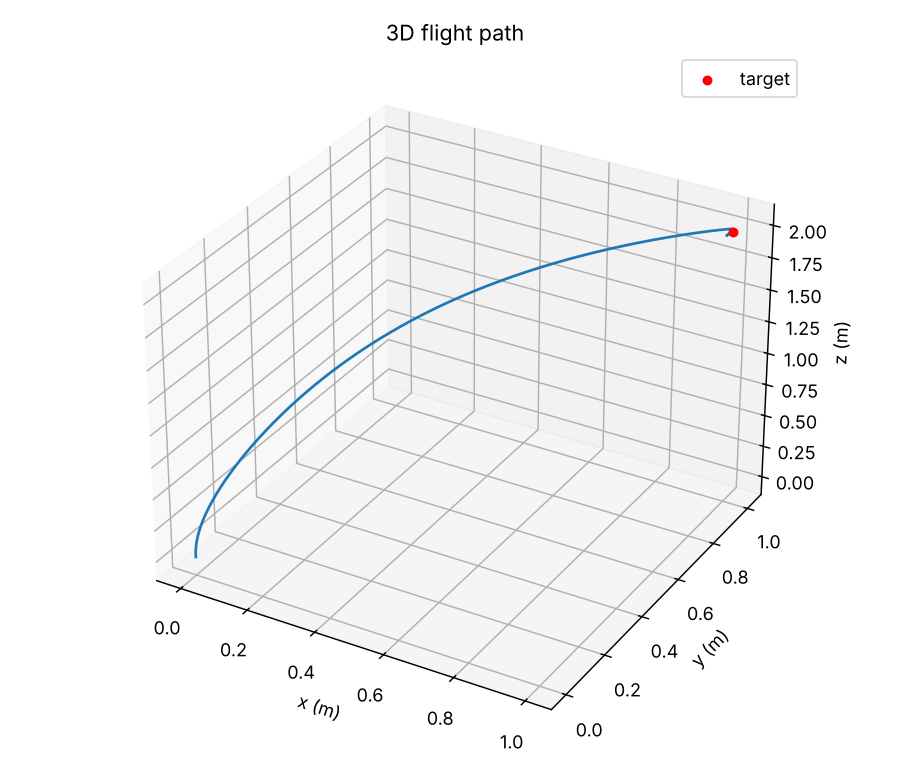

# Quadrotor Stability — Modeling & Simulation

Nonlinear modeling of an X-configuration quadrotor drone, a cascaded PID flight controller, and a stability study combining **linear analysis** (closed-loop poles, Routh-Hurwitz) with **nonlinear time-domain simulation** (tracking, wind-gust rejection, actuator saturation).



## Model

- **6-DOF rigid body**, 12 states: position, velocity, Z-Y-X Euler angles, body rates.
- Rotor thrust `F = kf·ω²` and drag torque `M = km·ω²`, X-layout **mixer** with per-rotor saturation (thrust-to-weight ≈ 3).
- Gyroscopic coupling `ω × Iω`, linear aerodynamic drag, ground contact.
- Integrated with a fixed-step **4th-order Runge-Kutta** at 500 Hz.

| Parameter | Value |
|---|---|
| Mass | 1.0 kg |
| Arm length | 0.17 m |
| Inertia (Ixx, Iyy, Izz) | 0.0082, 0.0082, 0.0149 kg·m² |
| Max thrust per rotor | 7.4 N |

## Controller

Cascaded architecture, inner loop ≈ 5-10× faster than the outer loop:

1. **Altitude PID** → collective thrust, with tilt compensation and conditional integration (anti-windup).
2. **Position PD** → desired roll/pitch, yaw-aware, limited to ±25°.
3. **Attitude PID** → body torques, then the mixer → rotor thrusts.

## Results

Scenario: take-off to (1, 1, 2) m with a 30° yaw change, then a wind-gust torque from t = 7.0 to 7.2 s.

| Loop | Rise time | Overshoot | Settling (2 %) | Final error |
|---|---|---|---|---|
| Altitude | 1.25 s | 0.7 % | 2.06 s | 0.009 m |
| Position x | 2.31 s | 0 % | 4.02 s | 0.002 m |
| Yaw | 0.41 s | 4.0 % | 4.63 s | 0.5° |

- **Gust rejection:** peak roll error 2.3°, position back within 1 cm by the end of the run.
- **Linear stability:** all closed-loop poles in the left half-plane (roll: ωn ≈ 12 rad/s, ζ ≈ 0.8). Routh-Hurwitz `Kd·Kp > Ki` holds on every axis.
- **Actuators:** rotors saturate only 0.1 % of the time (during take-off).

| Attitude | 3D path |
|---|---|
|  |  |

## Run it

```bash
pip install -r ../requirements.txt
python simulate.py              # prints metrics (JSON) and writes figures/
```

A MATLAB version of the linear analysis (poles, step, Bode margins, root locus) is in [`matlab/attitude_stability.m`](matlab/attitude_stability.m).

## Files

```
quadrotor/model.py        6-DOF dynamics, mixer, RK4 integrator
quadrotor/controller.py   cascaded PID controller
quadrotor/analysis.py     poles, Routh-Hurwitz check, step-response metrics
simulate.py               scenario, metrics and figures
matlab/                   linear stability analysis in MATLAB
```

## Next steps

Motor dynamics and sensor noise with a complementary or Kalman filter, LQR comparison, and hardware-in-the-loop on a flight controller.
